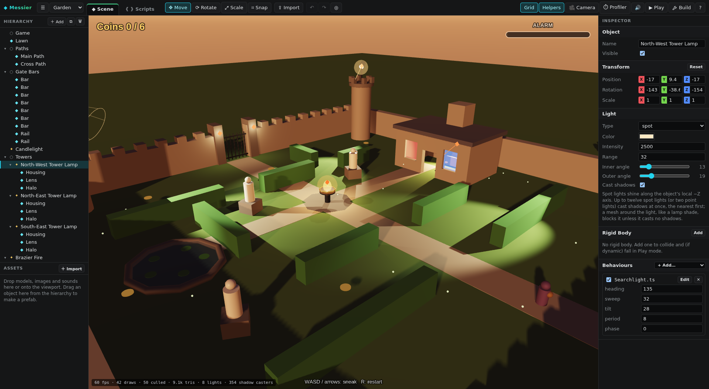

# Messier Engine

A browser-based 3D engine written in TypeScript on **WebGPU**, with a built-in
real-time scene editor. What changed in each version: [CHANGELOG.md](CHANGELOG.md).

- **Forward PBR renderer**: metallic-roughness GGX shading, ACES tone mapping,
  4× MSAA, reversed-Z depth, base color, normal, metallic-roughness, occlusion and
  emissive textures with GPU-generated mipmaps (normal maps need no stored tangents).
- **Dynamic lights**: up to 128 directional, point and spot lights, all
  updated every frame from the scene graph. The first shadow-casting
  directional light gets a 2048² PCF shadow map.
- **2D shapes and text**: rectangles (optionally rounded), ellipses, regular
  polygons and arbitrary paths, filled and outlined, plus signed-distance-field
  text that stays sharp at any size, with outlines, alignment and wrapping.
  Either in the world (on the object's XY plane, depth tested) or on screen as a
  HUD anchored to the viewport. Scripts can also draw immediate-mode shapes and
  text with `draw2d`.
- **Cameras**: perspective or orthographic camera components on scene
  objects. Play renders through the active camera, and scripts can move it
  or change its lens.
- **Model loading**: glTF 2.0 (`.gltf` + `.bin` + images, or binary `.glb`)
  and Wavefront OBJ + MTL, either from a URL or by dragging files onto the
  viewport.
- **Rigid body physics**: a `RigidBody` component with box and sphere
  colliders, dynamic / static / kinematic bodies, friction, restitution,
  damping and sleeping, solved with fixed-step sequential impulses.
- **Skies**: a gradient sky with a sun that follows the scene's directional
  light, or an equirectangular panorama image. The sky also lights the scene:
  metals reflect it, blurrier the rougher they are.
- **Audio**: an `AudioSource` component plays imported sound files (`.wav`,
  `.mp3`, `.ogg`…, saved inside the project) or sound effects from a built-in
  synthesizer (lasers, coins, explosions, from a few parameters, no files), in
  2D or positioned in 3D relative to the camera, through the Web Audio API.
- **TypeScript behaviour scripts**: write behaviours as TypeScript classes in
  the editor's built-in code editor (syntax highlighting, live error markers,
  auto-indent). Scripts compile as you type and hot-reload into a running
  scene. The TypeScript-to-JavaScript step is a small built-in type stripper,
  so there's no compiler dependency.
- **Real-time editor**: hierarchy tree with drag-and-drop re-parenting, live
  inspector, move/rotate/scale gizmos with snapping, undo/redo, duplicate and
  delete, and a Play mode that runs behaviours (scripts) and restores the scene
  when you stop.
- **Game builds**: the **Build** button next to Play (or **☰ → Build…**) picks and orders the scenes (Unity-style
  build settings) and downloads the game as a `.zip` holding one self-contained
  `index.html` that runs anywhere WebGPU does, even straight from disk.
- **No runtime dependencies**: the math, loaders, renderer and UI are all in2
  this repo. The only npm packages are build tools (Vite, TypeScript, WebGPU types).



## Running on NixOS (flake)

The flake provides Node.js 22 and everything else you need. You don't have to
install Node globally.

```sh
# Start the dev server (runs `npm install` on first use), then open http://localhost:5173
nix run

# Or work inside a dev shell with node/npm on PATH
nix develop
npm install
npm run dev

# Reproducible production build (static files in ./result/share/messier-engine)
nix build

# Serve that production build on http://localhost:8080
nix run .#serve
```

> **Tip:** Flakes copy the *whole directory* into the Nix store when it isn't a
> git repository, including `node_modules`. Run `git init && git add -A`
> first. After that, Nix only sees tracked files, which is much faster.

After changing npm dependencies, update `npmDepsHash` in `flake.nix`:

```sh
nix run nixpkgs#prefetch-npm-deps -- package-lock.json
```

### Other systems

Any machine with Node.js ≥ 18:

```sh
npm install
npm run dev        # dev server with hot reload
npm run build      # type-check + production build into dist/
npm run preview    # serve dist/
```

## Browser requirements

WebGPU needs a secure context. `localhost` counts as one.

| Browser | Notes |
| --- | --- |
| Chrome / Edge 113+ | Works out of the box on Windows, macOS and ChromeOS. |
| Chromium on Linux | Enable `chrome://flags/#enable-unsafe-webgpu`, or start it with `--enable-unsafe-webgpu --enable-features=Vulkan`. |
| Firefox 141+ | Enabled on Windows. On Linux/macOS set `dom.webgpu.enabled` in `about:config` (or use Nightly). |
| Safari 26+ | Supported. |

If WebGPU isn't available, the viewport shows an explanation instead of the scene.

## Using the editor

| Input | Action |
| --- | --- |
| Left click | Select. The first click on a model selects its root; click again to drill into the part under the cursor. |
| `Ctrl`+click / `Shift`+click | Add to or remove from the selection / select a range in the hierarchy. The inspector and gizmo show the last clicked object. |
| Right click in the hierarchy | Context menu: undo/redo, create (as a child of the item under the cursor), cut/copy/paste, paste as child, duplicate, delete, visibility |
| Left drag on empty space / Alt + left drag | Orbit |
| Middle drag / Shift + left drag | Pan |
| Mouse wheel | Zoom |
| Right drag + `W` `A` `S` `D` / `Q` `E` | Fly (hold Shift to go faster) |
| `W` / `E` / `R` | Move / rotate / scale gizmo |
| `X` | Toggle snapping (0.25 units, 15°, 0.1 scale) |
| `F` (or double-click in hierarchy) | Focus selection |
| `Ctrl+Z` / `Ctrl+Shift+Z` / `Ctrl+Y` | Undo / redo |
| `Ctrl+D` / `Del` | Duplicate / delete the selection (copies go right after their originals, named `Cube (1)`…) |
| `Ctrl+X` / `Ctrl+C` / `Ctrl+V` / `Ctrl+Shift+V` | Cut / copy / paste objects / paste as child of the active object (while the hierarchy or viewport has focus) |
| `Ctrl+A` | Select all objects (while the hierarchy or viewport has focus) |
| `P` | Play / stop (during Play, plain keys go to scripts; `Esc` stops) |
| `Ctrl+E` | Switch between the **Scene** and **Scripts** tabs |
| `Ctrl+S` / `Ctrl+Shift+S` | Save now / save to a new project folder (in the code editor, `Ctrl+S` also compiles now) |
| `Ctrl+O` | Open a project folder |
| `Ctrl+Shift+B` | Build settings: choose the game's scenes and download it as a `.zip` |
| `Ctrl+/` / `Tab` | In the code editor: toggle comment / indent (`Shift+Tab` outdents) |
| `G` / `H` | Toggle grid / light and camera helpers |
| `C` | Look through the scene camera (Play turns this on) |
| `Esc` | Deselect |
| `?` | Shortcut overview |

- **Gizmo handles:** drag an arrow (move), ring (rotate) or cube (scale) to
  constrain to one axis. Drag the center handle to move in the screen plane,
  or to scale uniformly.
- **Inspector:** drag the colored `X`/`Y`/`Z` tags (or any number label) left
  and right to scrub a value. Hold Shift for ×10, Alt for ×0.1. Values update
  live while objects move or animate.
- **Projects and scenes:** a project is a folder, like in Godot or Unity:

  ```
  MyGame/
    project.json          name, build settings, start scene
    scenes/Main.messier   one file per scene (JSON)
    scripts/Player.ts     one file per script
    assets/               imported models, images and sounds, and prefabs (*.prefab), in any subfolders
      models/ship.glb
      models/ship.glb.meta   the file's id, which scenes refer to
    tsconfig.json         lets VS Code check scripts against…
    .messier/messier.d.ts …the types of the 'messier' module
  ```

  The **☰** menu creates (**New Project…**), opens (`Ctrl+O`) and saves
  projects, renames the open scene (type in its name field and press Enter),
  adds and deletes scenes, and builds the game; the picker next to it switches
  scenes (not during Play). With nothing selected, the inspector renames the
  project and scene or deletes the scene. Switching scenes clears undo.
  - A project folder is **saved as you work**: about a second after a change,
    the scene, script and `project.json` files that changed are written. The
    ☰ menu shows the folder's name. The next visit offers to reopen it (the
    browser asks for permission again).
  - **Assets sync live.** Anything copied into `assets/`, from the file manager
    or another program, shows up in the **Assets** panel (under the hierarchy)
    within a second, loaded and ready to drag into the viewport (models and
    sounds), onto an object (images become its texture) or onto the sky.
    Changing a file reloads it everywhere it's used. Every asset gets a `.meta`
    file with its id; move or rename a file together with its `.meta` and
    scenes keep finding it (renaming in the Assets panel moves both).
  - **Scripts are files too.** Edit `scripts/*.ts` in VS Code and the editor
    picks up the change and hot-reloads it, even during Play. Every project
    folder the editor writes gets `.messier/messier.d.ts` (the types of the
    `'messier'` module scripts import from) and a `tsconfig.json` using it, so
    VS Code type-checks and autocompletes scripts. The types are updated when
    the project opens in another version; an existing `tsconfig.json` is left
    alone.
  - **Export** (☰ → **Export to Folder…** or **Export as .zip**) writes a copy
    of the project, script types included, without moving the editor to it.
  - Folders need the File System Access API: Chrome or Edge. The first visit
    (and any other browser) works on a project **kept in the browser**
    (IndexedDB, saved about a second after a change); **Save** (`Ctrl+S`) puts
    it into a folder, or in other browsers downloads the same folder as a
    `.zip` (also **☰ → Download as .zip**). **Open Project…** reads a project
    folder there too, keeping changes in the browser.
  - Single-file `.messier` projects from before version 0.4 still open (drop
    one on the viewport or import it); save to turn one into a folder. A scene
    file (`.messier`) dropped on the editor joins the project as a scene.
  - Saving during Play stops Play first, so the files have the edit-time scene.
  - Scene and prefab files carry a format version. Files from older versions
    open and are saved again in the current format; a file from a newer version
    is refused rather than misread.
  - Meshes are saved by reference (primitive parameters, or which asset they
    came from), never as vertex data. Meshes created by scripts at runtime
    can't be saved; Save tells you which objects lost theirs.
- **Prefabs:** drag an object from the hierarchy onto the **Assets** panel (or
  right-click it → **Create Prefab**) to save it with its children as
  `assets/<Name>.prefab`; the object becomes an *instance* of it. Drag the
  prefab into the viewport or the hierarchy, or double-click it, to add more.
  Instances are tinted in the hierarchy. A scene saves an instance as a link
  plus what it changes (edited fields, removed and added objects), so editing the
  prefab reaches every instance except where an instance overrides it. The
  inspector's *Prefab* section counts an instance's changes and has **Apply**
  (write them into the prefab; every instance in the scene updates), **Revert**
  (drop them) and **Unpack** (make plain objects). A prefab can contain
  instances of other prefabs, and a prefab made from an instance is a *variant*
  of that prefab. Prefab files are JSON: edited outside the editor, their
  instances update within a second. Scripts add instances with
  `this.scene.instantiate('Name')`.
- **Building a game:** the toolbar's **Build** button (also **☰ → Build…**, `Ctrl+Shift+B`) opens the build
  settings. Tick the scenes to include and drag them (or use ▲/▼) into order:
  the first one starts the game, and the numbers are the build indices that
  `sceneManager.loadScene()` takes. **Build** downloads `<title>.zip` with one
  `index.html`: the engine runtime, the scripts (compiled when the page loads)
  and the scenes and imported models they use, all inline. Open it in a
  WebGPU browser or upload it to any static host (itch.io, GitHub Pages…). The
  game plays through each scene's camera, full window, with the keyboard
  going to scripts. Script errors go to the browser console. The settings
  and the game title are saved with the project.
- **Environment:** with nothing selected, the inspector edits the sky,
  exposure, shadow extent and the grid.
- **Sky:** the *Sky* section picks a flat *color* (with the ambient light
  color), a *gradient* (top, horizon and ground colors and a sun that sits
  opposite the shadow-casting directional light), or an *image*: an
  equirectangular (2:1) panorama. Load one with **Load…** or drop a `.png`,
  `.jpg` or `.webp` on its own onto the viewport. Gradient and image skies light
  the scene too; *Sky light ×* sets how strongly. Topple uses a gradient sky.
- **Importing:** click **Import** or drop files onto the viewport. For
  multi-file assets, select or drop the `.gltf`/`.obj` *together with* its
  `.bin`, `.mtl` and texture files. Very large or very small models are rescaled
  to about 3 m and placed on the ground. Sound files (`.wav`, `.mp3`, `.ogg`,
  `.flac`, `.m4a`) become an object with an *Audio Source* playing them. An
  image dropped without a model becomes the sky. Images and sounds are saved in
  the project like models, and so are textures loaded into a material.
- **Play mode:** behaviours (Rotator, Bobber, Orbiter, LightPulse, ColorCycle)
  and physics only run while playing. When you press Stop, every transform,
  light color/intensity, camera setting and rigid body velocity goes back to
  its value from before Play.
- **Cameras:** add one with **＋ Add → Camera**, then click **Align to view**
  in the inspector to give it the editor's current view. Cameras look along
  their local −Z axis. The visible camera with the highest *Priority* is the
  active one (ties go to the camera higher in the hierarchy). Play renders
  through it and hides the grid, helpers and gizmos. Press **🎥 Camera** to
  switch back to the editor camera during Play, or press `C` to look through
  the camera while editing. While you look through a scene camera, the
  viewport doesn't orbit or select. Stop restores camera settings that
  scripts changed.
- **2D shapes and text:** **＋ Add → 2D** creates a rectangle, ellipse,
  polygon or text standing in front of the view, or a *Screen Text (HUD)*
  label in the viewport's top-left corner. In world space, sizes are meters and
  the shape faces the object's +Z. In screen space, the position is in pixels
  from the chosen *Anchor* (+Y up) and the editor shows a pixel outline instead
  of the gizmo: click a HUD element to select it, then drag it to move it.
  Colors are display colors (like CSS), not affected by lighting. Higher
  *Order* draws on top. The Gem Rush score at the top of the screen is a
  `Text2D` that its `ScoreHud` script rewrites.
- **Sound:** **＋ Add → Audio Source** creates an object with an *Audio
  Source*, or pick **Audio Source** in an object's **+ Add…** menu. Its *Clip*
  is an imported sound or a synthesized effect (**Vary** makes a random
  variation, **▶** previews it). Sources play in Play mode: *Play on start*
  starts one with the scene, scripts call `play()` or `playOneShot()`.
  *Spatial* sources are heard from their object, at full volume up to *Min
  distance* and silent beyond *Max distance*. The toolbar's 🔊 mutes the editor.
  Browsers only allow sound after you've clicked or typed on the page.
- **Physics:** select an object and click **Add** in the inspector's *Rigid
  Body* section. The collider is fitted to the mesh (spheres get a sphere
  collider, flat meshes like planes become static slabs) and drawn in green.
  - **Dynamic** bodies fall and collide.
  - **Static** bodies never move.
  - **Kinematic** bodies follow their transform, for example when driven by a
    behaviour, and push dynamic bodies out of the way.
  
  Moving a dynamic body with the gizmo during Play teleports it and restarts
  it from rest. Gravity and solver iterations are in the scene settings.
  In the demo, press Play to drop the ball onto the crate stack.
- **Scripts:** the tabs at the top switch between the scene editor and the
  script editor. To start a script, pick **＋ New script…** in an object's
  *Behaviours* menu (or **＋ New** in the Scripts tab, then attach it from the
  menu). See [Behaviour scripts](#behaviour-scripts) below.

Objects are also reachable from the browser console as `engine` and `editor`,
for example `engine.scene.findByName('Sun').light.intensity = 5`.

## Using the engine in code

```ts
import { CameraComponent, Engine, GameObject, Light, Material, RigidBody, Rotator, createCube, createPlane, createSphere, fitCollider, loadModelFromURL, quat, vec3 } from './engine';

const engine = await Engine.create(document.querySelector('canvas')!);

const cube = new GameObject('Cube');
cube.mesh = createCube(1);
cube.material = new Material('Red', { baseColor: [0.8, 0.1, 0.1, 1], roughness: 0.4 });
cube.transform.position = [0, 0.5, 0];
cube.addComponent(Rotator, { speedY: 90 }); // components: addComponent / getComponent / removeComponent
engine.scene.add(cube);

const sun = new GameObject('Sun');
sun.light = new Light('directional', [1, 0.95, 0.9], 2);
sun.light.castShadows = true;
sun.transform.setEulerDeg(-50, 30, 0); // lights shine along local -Z
engine.scene.add(sun);

const floor = new GameObject('Floor');
floor.mesh = createPlane(20);
floor.rigidBody = new RigidBody('static');
fitCollider(floor.rigidBody, floor.mesh); // plane -> 0.2 m slab below y = 0
engine.scene.add(floor);

const ball = new GameObject('Ball');
ball.mesh = createSphere(0.5);
ball.transform.position = [0, 4, 0];
ball.rigidBody = new RigidBody('dynamic', { shape: 'sphere', radius: 0.5, restitution: 0.6 });
engine.scene.add(ball);
// From a behaviour or anywhere else: ball.rigidBody.addImpulse([2, 0, 0]);

const cam = new GameObject('Main Camera');
cam.camera = new CameraComponent({ fovDeg: 50 }); // or { projection: 'orthographic', orthoSize: 5 }
cam.transform.position = [0, 4, 10];
cam.transform.rotation = quat.lookRotation(vec3.sub([0, 1, 0], cam.transform.position)); // cameras look along local -Z
engine.scene.add(cam); // the engine renders through scene.activeCamera(), or engine.camera when there is none

engine.scene.add(await loadModelFromURL('/models/lantern.glb'));
engine.setPlaying(true); // run behaviours and physics
engine.start();
```

Objects are composed from components (`MeshRenderer`, `Light`, `CameraComponent`,
`RigidBody`, behaviours); `obj.mesh`, `obj.light` and friends are shortcuts. See
[docs/scripting.md](docs/scripting.md) for the component, lifecycle, transform,
signal and `Time` APIs.

To add a built-in behaviour, subclass `Behaviour` in `src/engine/behaviours.ts`,
give it a `static readonly typeName` and register it in `BEHAVIOURS`. It then
shows up in the inspector's **Add…** menu, and its public number fields become
editable parameters automatically.

## Behaviour scripts

A script is a TypeScript file whose default export is a class extending
`Script`. It imports engine API from the `'messier'` module:

```ts
import { Script, vec3, type Vec3 } from 'messier';

export default class Hover extends Script {
  /** Public number fields are inspector parameters. */
  size = 0.8;
  speed = 0.2;
  private home: Vec3 = [0, 0, 0]; // private, protected and _-prefixed fields stay hidden

  start(): void {
    this.home = vec3.clone(this.object.transform.position);
  }

  update(dt: number, time: number): void {
    const a = time * this.speed * Math.PI * 2;
    this.object.transform.position = vec3.add(this.home, [Math.sin(a) * this.size, 0, Math.sin(a * 2) * this.size * 0.5]);
  }
}
```

- A script is a component (`Script` extends `Behaviour`). `this.object` is the
  `GameObject`, `this.transform` its transform, `this.scene` the `Scene` it's in
  (`query()`, `getGroup()`, `findByName()`, `activeCamera()`, `physics`…), and
  `this.find(name)` looks up another object. For example, a follow camera can move
  `this.find('Main Camera')` each frame, and `this.object.camera.fovDeg` changes a camera's zoom.
- Lifecycle hooks: `awake()`, `onEnable()`, `start()`, `fixedUpdate(fixedDt)`,
  `update(dt, time)`, `lateUpdate(dt)`, `onDisable()`, `onDestroy()`. They run
  only in Play, which runs a copy of the scene, so Stop undoes whatever scripts
  did. Scripts can create and destroy objects (`GameObject.instantiate`,
  `GameObject.destroy`), add components and use typed `Signal`s; see
  [docs/scripting.md](docs/scripting.md).
- Scripts compile while you type. Errors are underlined in the editor, listed
  under *Problems* and counted on the Scripts tab. Runtime errors are mapped
  back to the source line, and the throwing behaviour pauses until the script
  changes.
- A script that compiles replaces the class on every object using it, even
  during Play. Running instances keep their state (fields) and get the new
  methods.
- Inspector values are stored as overrides. Changing a field's default in code
  updates every object that hasn't overridden it.
- Scripts are part of the project: `scripts/<Name>.ts` in a project folder,
  written as you edit and reloaded when changed on disk.
  Download one with **⤓ Download**, or import `.ts` files with **Import** or by
  dropping them on the viewport.
- Types are erased, not checked: annotations, generics, `as`, `satisfies`, `!`,
  interfaces, type aliases, overloads, `declare` and modifiers are supported.
  Syntax that needs code generation (enums, namespaces, decorators,
  constructor parameter properties) is reported as an error. This is the same
  rule as Node's `--experimental-strip-types`.

### Keyboard input

`input` (from `'messier'`) holds the keyboard state. Keys are named by
[`KeyboardEvent.code`](https://developer.mozilla.org/docs/Web/API/UI_Events/Keyboard_event_code_values)
(`'KeyW'`, `'ArrowUp'`, `'Space'`, `'ShiftLeft'`…), so they stay in the same
place on any keyboard layout.

```ts
import { Script, input } from 'messier';

export default class Player extends Script {
  speed = 3; // meters per second
  jump = 5;

  update(dt: number): void {
    // A/D or ←/→, and S/W or ↓/↑: -1, 0 or 1
    let x = input.axis('horizontal');
    let z = -input.axis('vertical'); // forward is −Z
    const len = Math.hypot(x, z);
    if (len > 1) [x, z] = [x / len, z / len]; // diagonals aren't faster

    const speed = input.isDown('ShiftLeft', 'ShiftRight') ? this.speed * 2 : this.speed;
    const body = this.object.rigidBody;
    if (body?.type === 'dynamic') {
      // Set the velocity: moving a dynamic body's transform counts as a teleport.
      body.velocity = [x * speed, body.velocity[1], z * speed];
      if (input.pressed('Space')) body.velocity = [body.velocity[0], this.jump, body.velocity[2]];
      if (x || z) body.wake(); // a resting body sleeps and ignores velocity changes
    } else {
      const p = this.object.transform.position;
      this.object.transform.position = [p[0] + x * speed * dt, p[1], p[2] + z * speed * dt];
    }
  }
}
```

| Call | Returns |
| --- | --- |
| `input.isDown(...codes)` | `true` while any of the keys is held |
| `input.pressed(...codes)` / `input.released(...codes)` | `true` for one frame after any of the keys went down / up (key repeat doesn't count) |
| `input.axis('horizontal' \| 'vertical')` | -1, 0 or 1 from A/D + ←/→ or S/W + ↓/↑ (up is positive) |
| `input.axis(negativeKeys, positiveKeys)` | the same for your own keys, e.g. `input.axis(['KeyQ'], ['KeyE'])` |

While playing, the viewport has the keyboard: plain keys go to scripts
instead of the editor's shortcuts (so `W` doesn't switch the gizmo), and
**Esc** stops Play. Ctrl shortcuts and right-drag fly still work, and typing
in an inspector field or the code editor never reaches the game. Key state is
cleared on Play, Stop and when the window loses focus. Outside the editor,
forward events yourself with `input.keyDown(e.code)` / `input.keyUp(e.code)`.

### Scripts from code

From code, scripts are assets in `scene.scripts`:

```ts
import { ScriptAsset } from './engine';

const hover = engine.scene.scripts.add(new ScriptAsset('Hover', source));
hover.compile(); // false on errors; see hover.diagnostics
obj.attachComponent(hover.create({ speed: 0.5 })); // a Script component, with optional overrides
```

## Project layout

```
flake.nix               Nix: dev shell, `nix run` dev server, static build, `.#serve`, `.#tests` shell
index.html              Editor shell (toolbar, panels, canvas)
src/main.ts             Entry point: creates the engine and editor, restores the autosave or builds the demo project
src/demoProject.ts      The demo project: Main, the showcase scenes, scripts, sample models, build order
src/demo.ts             Demo scene content
src/demos/              Showcase games (Arcade, Neon Run, Topple, Starfall)
docs/scripting.md       Scripting API: components, lifecycle, transform, signals, Time
src/engine/             The engine (no DOM dependencies except the canvas)
  engine.ts             Main loop: fixed steps → update → lateUpdate → matrices → render → destroys; active scene
  input.ts              Keyboard state for scripts (isDown / pressed / axis); the host forwards key events
  audio.ts              Web Audio output (voices, listener, mute); the host calls audio.resume() on a gesture
  audioSource.ts        AudioSource component and its per-frame lifecycle; audioClip.ts: AudioClip (+ ClipRef)
  sfx.ts                Sound-effect synthesizer (SfxParams, SFX_PRESETS, renderSfx)
  sky.ts                Sky settings (color / gradient / image) of a scene
  scripting.ts          Script component, ScriptAsset (compile, diagnostics, in-place hot reload)
  typescript.ts         Tokenizer + position-preserving TypeScript type stripper
  renderer.ts           WebGPU device, pipelines, the frame's passes (shadow, main HDR, tonemap, overlay), uploads
  frameGraph.ts         Frame graph: pass ordering and culling, pooled transient textures, store ops
  shaders/*.wgsl        common (shared structs, sky lookup), mesh (PBR), sky, tonemap (exposure + ACES), shadow, grid,
                        overlay, mipmap, shape2d (2D + SDF text)
  scene.ts              GameObject (components, groups, destroy/instantiate), Scene (registry, lifecycle)
  transform.ts          Transform: hierarchy, cached local/world matrices, world-space helpers
  component.ts          Component base class; meshRenderer.ts: MeshRenderer
  behaviours.ts         Behaviour (lifecycle hooks) and the built-in behaviours
  signal.ts time.ts     Typed signals; Time (frame timing, fixed-step accumulator)
  camera.ts             Camera (the view the renderer draws from) and CameraComponent (scene cameras)
  mesh.ts material.ts light.ts primitives.ts
  physics.ts            RigidBody component, colliders, contact generation, impulse solver
  overlay.ts            Immediate-mode helper geometry (gizmos, icons, boxes)
  shapes2d.ts           Shape2D / Text2D components (world or screen space)
  draw2d.ts             2D tessellation (fill, stroke, ear clipping, glyph quads) and the draw2d immediate API
  font.ts               SDF glyph atlas (rasterize, distance transform, shelf packing) and text layout
  raycast.ts            Ray/AABB/triangle/sphere tests, scene picking, world bounds
  math.ts               vec3 / quat / mat4 (column-major), color helpers
  loaders/              glTF 2.0 / GLB, OBJ + MTL, resource resolvers, model assets
  serialize.ts          Scene <-> JSON (SceneData); meshes and textures as ResourceRefs; prefab instances
  prefab.ts             Prefab files, expanding instances and diffing them against their prefab
  sceneFormat.ts        Scene/prefab format version and the migrations that upgrade older files
  project.ts            Project (scenes, scripts, assets, build settings), its packed form (builds), ProjectResources
  projectFolder.ts      The project folder format: FolderIO, .meta ids, load/write, change detection
  sceneManager.ts       sceneManager: loadScene() by name or build index, for built games and editor Play
src/player.ts           Runtime of built games: boots the project embedded in the exported page
src/editor/             Editor UI (plain DOM, no framework)
  editor.ts             Input, selection, commands, play mode, import, overlay, Scene/Scripts tabs
  project.ts            ProjectManager: folder and browser projects, scenes, saving, applying folder changes
  folderIO.ts folderSync.ts  Directory handles as FolderIO; watching a project folder for outside changes
  assets.ts             The Assets panel
  build.ts zip.ts       Build Settings dialog, exported page, .zip writer
  scriptsView.ts        Scripts tab: script list, problems, usages, reference
  codeEditor.ts         Textarea-over-highlight code editor (indent, comments, error markers)
  gizmo.ts              Move/rotate/scale manipulator (picking + dragging + drawing)
  hierarchy.ts inspector.ts ui.ts history.ts orbitControls.ts editor.css
public/models/          Sample assets (lantern.glb, icosahedron.obj/.mtl, material-lab.glb)
src/materialLab/        The Material Lab example project's scenes and scripts
examples/Demo/          The demo project as a project folder, its own git repository (npm run generate:demo; ignored)
examples/MaterialLab/   The Material Lab project folder, its own git repository (npm run generate:materials; ignored)
CHANGELOG.md            Changes per version; npm run release -- <patch|minor|major> cuts a version
scripts/                messier-types.mjs + types-plugin.mjs (messier.d.ts for project folders),
                        generate-sample-glb.mjs (regenerates lantern.glb), generate-material-glb.mjs
                        (material-lab.glb), glb.mjs (their PNG/GLB writer), release.mjs, generate-demo-project.mjs
                        and generate-material-lab.mjs (regenerate examples/Demo/ and examples/MaterialLab/, through
                        example-project.mjs), mangle-props.mjs (release build),
                        player-plugin.mjs (bundles src/player.ts into messier-player.js for builds)
tests/                  Unit tests and optional GPU smoke tests (separate package.json)
```

## Tests

The app itself only needs `npm run typecheck` / `npm run build`. `tests/` has
unit tests that need only Node, and smoke tests that exercise the real GPU:

- **`test:unit`** bundles `tests/unit/*.test.ts` with esbuild and runs them under
  Node: signals, `Time`'s fixed-step accumulator, transforms, the component
  registry, the behaviour lifecycle (order, activation, destroy during update…),
  scripts, 2D tessellation, text layout and the distance field, and the docs
  example. `node unit/run.mjs lifecycle` runs one file.

- **`test:render`** runs the engine under Node with Dawn (the `webgpu` npm
  package). It checks the math, loaders, picking, gizmo and physics logic,
  compares the type stripper's output with esbuild on a snippet corpus and on
  the repo's own sources, runs behaviour scripts (errors, hot reload), checks that
  rendering the demo scene (with 2D shapes, a HUD and stand-in glyphs, since Node
  can't rasterize fonts) produces no WebGPU validation errors, and writes
  `tests/.out/frame.png`.
- **`test:ui`** starts Vite and drives the editor in headless Chromium:
  selection, gizmo drag, undo/redo, inspector edits, the Add menu,
  duplicate/delete, Play/Stop, drill-down picking, re-parenting, 2D text
  (inspector edits, dragging and picking a HUD label), and the
  Scripts tab (creating, editing, error markers, undo, running and deleting
  scripts). It also fails on any console error.

```sh
nix develop .#tests          # provides Chromium + the Vulkan loader for Dawn
npm install                  # app deps (needed by test:ui)
cd tests && npm install && npm test
```

The tests need a working Vulkan driver. On NixOS that means
`hardware.graphics.enable = true`.

## Supported formats and limitations

- **glTF 2.0:** node hierarchy, TRS or matrix transforms, triangle primitives,
  indexed and non-indexed geometry, normalized/sparse accessors,
  metallic-roughness factors, base color, normal, metallic-roughness, occlusion and
  emissive textures (first UV set), emissive (plus
  `KHR_materials_emissive_strength`), alpha mask, double-sided,
  `KHR_materials_unlit`, `KHR_lights_punctual` and cameras. **Not supported:** skins,
  morph targets, animations, stored tangents (normal maps derive them per pixel),
  a second UV set, texture transforms, Draco/meshopt/Basis compression (the loader reports a
  clear error).
- **OBJ/MTL:** `v/vt/vn/f` (polygons are fan-triangulated, negative indices
  allowed), `o`/`g`/`usemtl` groups, `Kd`, `Ke`, `Ns`, `d`/`Tr`, `Pm`/`Pr`,
  `map_Kd`, `map_Ke` and normal maps (`norm`, or `map_Bump`/`bump` as Blender writes
  them, with `-bm` as the scale).
- **Rendering:** opaque only. Alpha *blend* materials render opaque; alpha
  *mask* works. One directional shadow map, no point or spot shadows.
  Environment lighting is a sky/ground gradient approximation, not
  image-based lighting.
- **2D:** text uses the browser's fonts through an `OffscreenCanvas`, without
  kerning or right-to-left shaping. 2D shapes aren't lit, don't cast shadows
  and don't collide. Text outlines reach about 0.15 × the font size.
- **Physics:** box and sphere colliders only (no mesh, capsule or compound
  colliders). Only objects with a rigid body collide; use a static body for
  scenery. There's no continuous collision detection, so very fast, small
  bodies can tunnel through thin colliders. Joints, triggers and collision
  layers aren't implemented. The broadphase is brute force, which is fine for
  a few hundred bodies.
- **Skies:** panoramas are 8-bit images (no `.hdr`/`.exr`), so *Brightness*
  stands in for real sky radiance. Sky reflections and ambient light use the
  image's mipmaps instead of prefiltered maps: plausible, not exact. Nothing
  occludes the sky light, so it reaches inside closed rooms too.
- **Audio:** no music streaming (sound files are decoded whole into memory),
  effects (reverb, filters) or doppler. Up to 32 sounds play at once; another
  one-shot replaces the oldest. Sound is silent until the first click or key
  press on the page, as browsers require.
- **Scripts:** no type checking or autocompletion. Scripts run on the main
  thread, so an infinite loop freezes the page. Scripts can only import from
  `'messier'` (not from each other). Input is keyboard only (no mouse or
  gamepad API yet).
- **Editor:** Objects added or deleted during Play
  stay that way after Stop (only transforms, light and camera settings and velocities are restored).
  Material and light edits aren't part of undo.

## License

From version 0.5.0, Messier is licensed under the
[PolyForm Shield License 1.0.0](LICENSE), with
[additional permissions](LICENSE-EXCEPTIONS.md) for what you make with it:

- **You may** use, study, modify and share Messier, and make games with it
  and sell them, without royalties and without having to include the license
  in your games.
- **You may not** sell or offer Messier itself, or a product that competes
  with it (another game engine or game-making tool built from it).
- Your scenes, scripts, assets and builds are yours.

Versions up to and including 0.4.0 were released under the MIT License, and
copies of them remain available under it.
