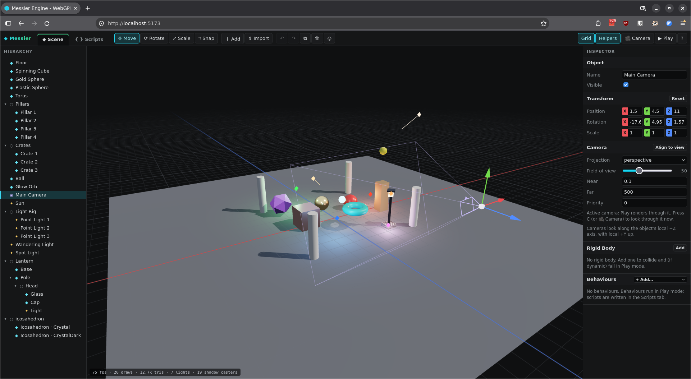

# Messier Engine

A browser-based 3D engine written in TypeScript on **WebGPU**, with a built-in
real-time scene editor.

- **Forward PBR renderer**: metallic-roughness GGX shading, ACES tone mapping,
  4× MSAA, reversed-Z depth, base-color textures with GPU-generated mipmaps.
- **Dynamic lights**: up to 128 directional, point and spot lights, all
  updated every frame from the scene graph. The first shadow-casting
  directional light gets a 2048² PCF shadow map.
- **Cameras**: perspective or orthographic camera components on scene
  objects. Play renders through the active camera, and scripts can move it
  or change its lens.
- **Model loading**: glTF 2.0 (`.gltf` + `.bin` + images, or binary `.glb`)
  and Wavefront OBJ + MTL, either from a URL or by dragging files onto the
  viewport.
- **Rigid body physics**: a `RigidBody` component with box and sphere
  colliders, dynamic / static / kinematic bodies, friction, restitution,
  damping and sleeping, solved with fixed-step sequential impulses.
- **TypeScript behaviour scripts**: write behaviours as TypeScript classes in
  the editor's built-in code editor (syntax highlighting, live error markers,
  auto-indent). Scripts compile as you type and hot-reload into a running
  scene. The TypeScript-to-JavaScript step is a small built-in type stripper,
  so there's no compiler dependency.
- **Real-time editor**: hierarchy tree with drag-and-drop re-parenting, live
  inspector, move/rotate/scale gizmos with snapping, undo/redo, duplicate and
  delete, and a Play mode that runs behaviours (scripts) and restores the scene
  when you stop.
- **No runtime dependencies**: the math, loaders, renderer and UI are all in
  this repo. The only npm packages are build tools (Vite, TypeScript, WebGPU types).



## Running on NixOS (flake)

The flake provides Node.js 22 and everything else you need. You don't have to
install Node globally.

```sh
# Start the dev server (runs `npm install` on first use), then open http://localhost:5173
nix run

# Or work inside a dev shell with node/npm on PATH
nix develop
npm install
npm run dev

# Reproducible production build (static files in ./result/share/messier-engine)
nix build

# Serve that production build on http://localhost:8080
nix run .#serve
```

> **Tip:** Flakes copy the *whole directory* into the Nix store when it isn't a
> git repository, including `node_modules`. Run `git init && git add -A`
> first. After that, Nix only sees tracked files, which is much faster.

After changing npm dependencies, update `npmDepsHash` in `flake.nix`:

```sh
nix run nixpkgs#prefetch-npm-deps -- package-lock.json
```

### Other systems

Any machine with Node.js ≥ 18:

```sh
npm install
npm run dev        # dev server with hot reload
npm run build      # type-check + production build into dist/
npm run preview    # serve dist/
```

## Browser requirements

WebGPU needs a secure context. `localhost` counts as one.

| Browser | Notes |
| --- | --- |
| Chrome / Edge 113+ | Works out of the box on Windows, macOS and ChromeOS. |
| Chromium on Linux | Enable `chrome://flags/#enable-unsafe-webgpu`, or start it with `--enable-unsafe-webgpu --enable-features=Vulkan`. |
| Firefox 141+ | Enabled on Windows. On Linux/macOS set `dom.webgpu.enabled` in `about:config` (or use Nightly). |
| Safari 26+ | Supported. |

If WebGPU isn't available, the viewport shows an explanation instead of the scene.

## Using the editor

| Input | Action |
| --- | --- |
| Left click | Select. The first click on a model selects its root; click again to drill into the part under the cursor. |
| Left drag on empty space / Alt + left drag | Orbit |
| Middle drag / Shift + left drag | Pan |
| Mouse wheel | Zoom |
| Right drag + `W` `A` `S` `D` / `Q` `E` | Fly (hold Shift to go faster) |
| `W` / `E` / `R` | Move / rotate / scale gizmo |
| `X` | Toggle snapping (0.25 units, 15°, 0.1 scale) |
| `F` (or double-click in hierarchy) | Focus selection |
| `Ctrl+Z` / `Ctrl+Shift+Z` / `Ctrl+Y` | Undo / redo |
| `Ctrl+D` / `Del` | Duplicate / delete |
| `P` | Play / stop (during Play, plain keys go to scripts; `Esc` stops) |
| `Ctrl+E` | Switch between the **Scene** and **Scripts** tabs |
| `Ctrl+S` / `Ctrl+/` / `Tab` | In the code editor: compile now / toggle comment / indent (`Shift+Tab` outdents) |
| `G` / `H` | Toggle grid / light and camera helpers |
| `C` | Look through the scene camera (Play turns this on) |
| `Esc` | Deselect |
| `?` | Shortcut overview |

- **Gizmo handles:** drag an arrow (move), ring (rotate) or cube (scale) to
  constrain to one axis. Drag the center handle to move in the screen plane,
  or to scale uniformly.
- **Inspector:** drag the colored `X`/`Y`/`Z` tags (or any number label) left
  and right to scrub a value. Hold Shift for ×10, Alt for ×0.1. Values update
  live while objects move or animate.
- **Environment:** with nothing selected, the inspector edits ambient light,
  background, exposure, shadow extent and the grid.
- **Importing:** click **Import** or drop files onto the viewport. For
  multi-file assets, select or drop the `.gltf`/`.obj` *together with* its
  `.bin`, `.mtl` and texture files. Very large or very small models are rescaled
  to about 3 m and placed on the ground.
- **Play mode:** behaviours (Rotator, Bobber, Orbiter, LightPulse, ColorCycle)
  and physics only run while playing. When you press Stop, every transform,
  light color/intensity, camera setting and rigid body velocity goes back to
  its value from before Play.
- **Cameras:** add one with **＋ Add → Camera**, then click **Align to view**
  in the inspector to give it the editor's current view. Cameras look along
  their local −Z axis. The visible camera with the highest *Priority* is the
  active one (ties go to the camera higher in the hierarchy). Play renders
  through it and hides the grid, helpers and gizmos. Press **🎥 Camera** to
  switch back to the editor camera during Play, or press `C` to look through
  the camera while editing. While you look through a scene camera, the
  viewport doesn't orbit or select. Stop restores camera settings that
  scripts changed.
- **Physics:** select an object and click **Add** in the inspector's *Rigid
  Body* section. The collider is fitted to the mesh (spheres get a sphere
  collider, flat meshes like planes become static slabs) and drawn in green.
  - **Dynamic** bodies fall and collide.
  - **Static** bodies never move.
  - **Kinematic** bodies follow their transform, for example when driven by a
    behaviour, and push dynamic bodies out of the way.
  
  Moving a dynamic body with the gizmo during Play teleports it and restarts
  it from rest. Gravity and solver iterations are in the scene settings.
  In the demo, press Play to drop the ball onto the crate stack.
- **Scripts:** the tabs at the top switch between the scene editor and the
  script editor. To start a script, pick **＋ New script…** in an object's
  *Behaviours* menu (or **＋ New** in the Scripts tab, then attach it from the
  menu). See [Behaviour scripts](#behaviour-scripts) below.

Objects are also reachable from the browser console as `engine` and `editor`,
for example `engine.scene.findByName('Sun').light.intensity = 5`.

## Using the engine in code

```ts
import { CameraComponent, Engine, GameObject, Light, Material, RigidBody, Rotator, createCube, createPlane, createSphere, fitCollider, loadModelFromURL, quat, vec3 } from './engine';

const engine = await Engine.create(document.querySelector('canvas')!);

const cube = new GameObject('Cube');
cube.mesh = createCube(1);
cube.material = new Material('Red', { baseColor: [0.8, 0.1, 0.1, 1], roughness: 0.4 });
cube.transform.position = [0, 0.5, 0];
cube.behaviours.push(new Rotator({ speedY: 90 }));
engine.scene.add(cube);

const sun = new GameObject('Sun');
sun.light = new Light('directional', [1, 0.95, 0.9], 2);
sun.light.castShadows = true;
sun.transform.setEulerDeg(-50, 30, 0); // lights shine along local -Z
engine.scene.add(sun);

const floor = new GameObject('Floor');
floor.mesh = createPlane(20);
floor.rigidBody = new RigidBody('static');
fitCollider(floor.rigidBody, floor.mesh); // plane -> 0.2 m slab below y = 0
engine.scene.add(floor);

const ball = new GameObject('Ball');
ball.mesh = createSphere(0.5);
ball.transform.position = [0, 4, 0];
ball.rigidBody = new RigidBody('dynamic', { shape: 'sphere', radius: 0.5, restitution: 0.6 });
engine.scene.add(ball);
// From a behaviour or anywhere else: ball.rigidBody.addImpulse([2, 0, 0]);

const cam = new GameObject('Main Camera');
cam.camera = new CameraComponent({ fovDeg: 50 }); // or { projection: 'orthographic', orthoSize: 5 }
cam.transform.position = [0, 4, 10];
cam.transform.rotation = quat.lookRotation(vec3.sub([0, 1, 0], cam.transform.position)); // cameras look along local -Z
engine.scene.add(cam); // the engine renders through scene.activeCamera(), or engine.camera when there is none

engine.scene.add(await loadModelFromURL('/models/lantern.glb'));
engine.setPlaying(true); // run behaviours and physics
engine.start();
```

To add a built-in behaviour, subclass `Behaviour` in `src/engine/behaviours.ts`
and register it in `BEHAVIOURS`. It then shows up in the inspector's
**Add…** menu, and its numeric `params` become editable fields automatically.

## Behaviour scripts

A script is a TypeScript file whose default export is a class extending
`Script`. It imports engine API from the `'messier'` module:

```ts
import { Script, vec3, type Vec3 } from 'messier';

export default class Hover extends Script {
  /** Public number fields are inspector parameters. */
  size = 0.8;
  speed = 0.2;
  private home: Vec3 = [0, 0, 0]; // private, protected and _-prefixed fields stay hidden

  start(): void {
    this.home = vec3.clone(this.object.transform.position);
  }

  update(dt: number, time: number): void {
    const a = time * this.speed * Math.PI * 2;
    this.object.transform.position = vec3.add(this.home, [Math.sin(a) * this.size, 0, Math.sin(a * 2) * this.size * 0.5]);
  }
}
```

- `this.object` is the `GameObject`, and `this.find(name)` looks up another
  object. For example, a follow camera can move `this.find('Main Camera')`
  each frame, and `this.object.camera.fovDeg` changes a camera's zoom. `start()` runs when Play starts, `update(dt, time)` every frame.
- Scripts compile while you type. Errors are underlined in the editor, listed
  under *Problems* and counted on the Scripts tab. Runtime errors are mapped
  back to the source line, and the throwing behaviour pauses until the script
  changes.
- A script that compiles replaces the class on every object using it, even
  during Play. Running instances keep their state (fields) and get the new
  methods.
- Inspector values are stored as overrides. Changing a field's default in code
  updates every object that hasn't overridden it.
- Scripts are saved in the browser's `localStorage` and restored on reload.
  Download them with **⤓ Download**, or import `.ts` files with **Import** or by
  dropping them on the viewport.
- Types are erased, not checked: annotations, generics, `as`, `satisfies`, `!`,
  interfaces, type aliases, overloads, `declare` and modifiers are supported.
  Syntax that needs code generation (enums, namespaces, decorators,
  constructor parameter properties) is reported as an error. This is the same
  rule as Node's `--experimental-strip-types`.

### Keyboard input

`input` (from `'messier'`) holds the keyboard state. Keys are named by
[`KeyboardEvent.code`](https://developer.mozilla.org/docs/Web/API/UI_Events/Keyboard_event_code_values)
(`'KeyW'`, `'ArrowUp'`, `'Space'`, `'ShiftLeft'`…), so they stay in the same
place on any keyboard layout.

```ts
import { Script, input } from 'messier';

export default class Player extends Script {
  speed = 3; // meters per second
  jump = 5;

  update(dt: number): void {
    // A/D or ←/→, and S/W or ↓/↑: -1, 0 or 1
    let x = input.axis('horizontal');
    let z = -input.axis('vertical'); // forward is −Z
    const len = Math.hypot(x, z);
    if (len > 1) [x, z] = [x / len, z / len]; // diagonals aren't faster

    const speed = input.isDown('ShiftLeft', 'ShiftRight') ? this.speed * 2 : this.speed;
    const body = this.object.rigidBody;
    if (body?.type === 'dynamic') {
      // Set the velocity: moving a dynamic body's transform counts as a teleport.
      body.velocity = [x * speed, body.velocity[1], z * speed];
      if (input.pressed('Space')) body.velocity = [body.velocity[0], this.jump, body.velocity[2]];
      if (x || z) body.wake(); // a resting body sleeps and ignores velocity changes
    } else {
      const p = this.object.transform.position;
      this.object.transform.position = [p[0] + x * speed * dt, p[1], p[2] + z * speed * dt];
    }
  }
}
```

| Call | Returns |
| --- | --- |
| `input.isDown(...codes)` | `true` while any of the keys is held |
| `input.pressed(...codes)` / `input.released(...codes)` | `true` for one frame after any of the keys went down / up (key repeat doesn't count) |
| `input.axis('horizontal' \| 'vertical')` | -1, 0 or 1 from A/D + ←/→ or S/W + ↓/↑ (up is positive) |
| `input.axis(negativeKeys, positiveKeys)` | the same for your own keys, e.g. `input.axis(['KeyQ'], ['KeyE'])` |

While playing, the viewport has the keyboard: plain keys go to scripts
instead of the editor's shortcuts (so `W` doesn't switch the gizmo), and
**Esc** stops Play. Ctrl shortcuts and right-drag fly still work, and typing
in an inspector field or the code editor never reaches the game. Key state is
cleared on Play, Stop and when the window loses focus. Outside the editor,
forward events yourself with `input.keyDown(e.code)` / `input.keyUp(e.code)`.

### Scripts from code

From code, scripts are assets in `scene.scripts`:

```ts
import { ScriptAsset, ScriptBehaviour } from './engine';

const hover = engine.scene.scripts.add(new ScriptAsset('Hover', source));
hover.compile(); // false on errors; see hover.diagnostics
obj.behaviours.push(new ScriptBehaviour(hover, { speed: 0.5 })); // optional overrides
```

## Project layout

```
flake.nix               Nix: dev shell, `nix run` dev server, static build, `.#serve`, `.#tests` shell
index.html              Editor shell (toolbar, panels, canvas)
src/main.ts             Entry point: creates the engine, demo scene and editor, loads sample models
src/demo.ts             Demo scene content
src/engine/             The engine (no DOM dependencies except the canvas)
  engine.ts             Main loop: behaviours + physics → world matrices → hooks → render
  input.ts              Keyboard state for scripts (isDown / pressed / axis); the host forwards key events
  scripting.ts          Script base class, ScriptAsset (compile, diagnostics), ScriptBehaviour (hot reload)
  typescript.ts         Tokenizer + position-preserving TypeScript type stripper
  renderer.ts           WebGPU device, pipelines, shadow + main passes, uploads
  shaders/*.wgsl        common (shared structs), mesh (PBR), shadow, grid, overlay, mipmap
  scene.ts              Transform, GameObject (scene graph node), Scene
  camera.ts             Camera (the view the renderer draws from) and CameraComponent (scene cameras)
  mesh.ts material.ts light.ts behaviours.ts primitives.ts
  physics.ts            RigidBody component, colliders, contact generation, impulse solver
  overlay.ts            Immediate-mode helper geometry (gizmos, icons, boxes)
  raycast.ts            Ray/AABB/triangle/sphere tests, scene picking, world bounds
  math.ts               vec3 / quat / mat4 (column-major), color helpers
  loaders/              glTF 2.0 / GLB, OBJ + MTL, resource resolvers
src/editor/             Editor UI (plain DOM, no framework)
  editor.ts             Input, selection, commands, play mode, import, overlay, Scene/Scripts tabs
  scriptsView.ts        Scripts tab: script list, problems, usages, reference
  codeEditor.ts         Textarea-over-highlight code editor (indent, comments, error markers)
  gizmo.ts              Move/rotate/scale manipulator (picking + dragging + drawing)
  hierarchy.ts inspector.ts ui.ts history.ts orbitControls.ts editor.css
public/models/          Sample assets (lantern.glb, icosahedron.obj/.mtl)
scripts/                generate-sample-glb.mjs (regenerates lantern.glb)
tests/                  Optional GPU smoke tests (separate package.json)
```

## Tests

The app itself only needs `npm run typecheck` / `npm run build`. The optional
smoke tests in `tests/` exercise the real GPU:

- **`test:render`** runs the engine under Node with Dawn (the `webgpu` npm
  package). It checks the math, loaders, picking, gizmo and physics logic,
  compares the type stripper's output with esbuild on a snippet corpus and on
  the repo's own sources, runs behaviour scripts (errors, hot reload), checks that
  rendering the demo scene produces no WebGPU validation errors, and writes
  `tests/.out/frame.png`.
- **`test:ui`** starts Vite and drives the editor in headless Chromium:
  selection, gizmo drag, undo/redo, inspector edits, the Add menu,
  duplicate/delete, Play/Stop, drill-down picking, re-parenting, and the
  Scripts tab (creating, editing, error markers, undo, running and deleting
  scripts). It also fails on any console error.

```sh
nix develop .#tests          # provides Chromium + the Vulkan loader for Dawn
npm install                  # app deps (needed by test:ui)
cd tests && npm install && npm test
```

The tests need a working Vulkan driver. On NixOS that means
`hardware.graphics.enable = true`.

## Supported formats and limitations

- **glTF 2.0:** node hierarchy, TRS or matrix transforms, triangle primitives,
  indexed and non-indexed geometry, normalized/sparse accessors,
  metallic-roughness factors, base color texture, emissive (plus
  `KHR_materials_emissive_strength`), alpha mask, double-sided,
  `KHR_materials_unlit`, `KHR_lights_punctual` and cameras. **Not supported:** skins,
  morph targets, animations, normal/occlusion/metal-rough textures,
  texture transforms, Draco/meshopt/Basis compression (the loader reports a
  clear error).
- **OBJ/MTL:** `v/vt/vn/f` (polygons are fan-triangulated, negative indices
  allowed), `o`/`g`/`usemtl` groups, `Kd`, `Ke`, `Ns`, `d`/`Tr`, `Pm`/`Pr`
  and `map_Kd`.
- **Rendering:** opaque only. Alpha *blend* materials render opaque; alpha
  *mask* works. One directional shadow map, no point or spot shadows.
  Environment lighting is a sky/ground gradient approximation, not
  image-based lighting.
- **Physics:** box and sphere colliders only (no mesh, capsule or compound
  colliders). Only objects with a rigid body collide; use a static body for
  scenery. There's no continuous collision detection, so very fast, small
  bodies can tunnel through thin colliders. Joints, triggers and collision
  layers aren't implemented. The broadphase is brute force, which is fine for
  a few hundred bodies.
- **Scripts:** no type checking or autocompletion. Scripts run on the main
  thread, so an infinite loop freezes the page. Scripts can only import from
  `'messier'` (not from each other). Input is keyboard only (no mouse or
  gamepad API yet).
- **Editor:** no scene save/load yet (only script sources persist). Objects added or deleted during Play
  stay that way after Stop (only transforms, light and camera settings and velocities are restored).
  Material and light edits aren't part of undo.

## License

MIT. See [LICENSE](LICENSE).
